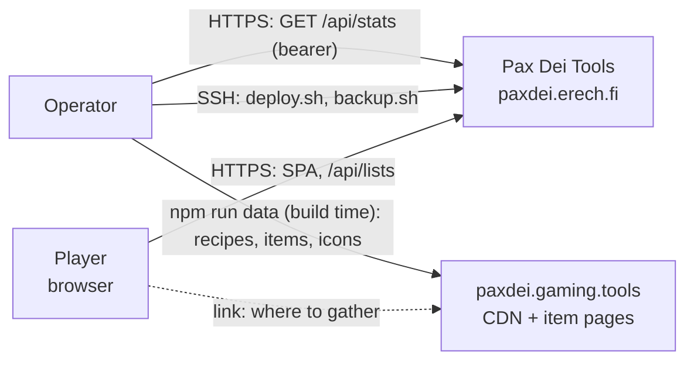
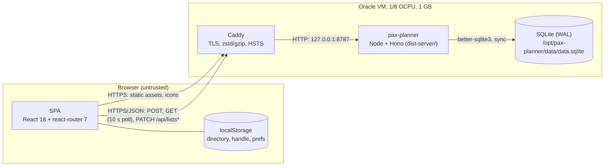

# Architecture

Updated: 2026-11-03 · Toolkit 1.5.2 · Crafting Planner 1.5.2

The one page to read first. It describes what *is*. Decisions are in [docs/adr/](adr/),
feature behaviour is in `docs/features/<slug>/spec.md`, and the capacity arithmetic is in
[CAPACITY.md](CAPACITY.md).

## 1. Context

Pax Dei Tools is a web suite for players of the MMO **Pax Dei**. It has one tool today,
the **Crafting Planner**. A player searches items, adds them to a list, and gets a
flattened plan of every raw material to gather and every intermediate to craft, with owned
stock subtracted. A group can share one list by link and divide the work, and see each
other's progress.

Users are Pax Dei players, often in groups or guilds, with no accounts
([ADR 0006](adr/0006-share-lists-by-secret-token-with-no-accounts.md)). The operator runs
one free-tier VM. Game data comes from paxdei.gaming.tools at **build time** only. At
runtime the app talks to nothing but its own origin
([ADR 0003](adr/0003-bundle-the-game-data-and-serve-every-asset-from-our-own-orig.md)).

## 2. Containers

| Container | Technology | Responsibility |
|---|---|---|
| SPA | React 18, react-router 7, Vite 6 | All UI and the recipe engine ([ADR 0002](adr/0002-run-the-recipe-engine-in-the-client-and-keep-the-server-as-s.md)). The dataset is a lazy chunk ([ADR 0004](adr/0004-lazy-load-the-dataset-as-its-own-hashed-chunk.md)). |
| pax-planner server | Node, Hono 4, `@hono/node-server` | Serves `dist/`, `/api/*` and `/healthz` from one origin ([ADR 0005](adr/0005-serve-the-spa-and-api-from-one-hono-and-sqlite-process.md)). Stores lists and progress, sets security headers, rate-limits, sweeps old lists and counts usage. |
| SQLite | better-sqlite3 12, WAL | Tables `lists`, `progress`, `meta`, `metrics`, `visitors`. Migrated idempotently on boot (`server/db.ts`). |
| Caddy | Caddy 2 | Auto-TLS, compression and HSTS, then a reverse proxy to loopback. Nothing else. |
| Data pipeline | tsx scripts | Not deployed as a service. `npm run data` builds `data/dataset.json` (committed) and `public/icons/` (build artifact). |

In development, Vite serves the SPA on 5173 and proxies `/api` to the server on 8787
(`npm run dev:all`).

## 3. Code map

| Path | Owns | Start reading at |
|---|---|---|
| `src/main.tsx`, `src/routes.tsx` | Boot and the route table, generated from the registry | `routes.tsx` |
| `src/tools/registry.tsx` | The list of tools: routes, cards, per-tool versions, lazy loading ([ADR 0001](adr/0001-split-the-suite-into-tools-behind-one-registry.md)) | the `tools` array |
| `src/shell/` | Header, nav, footer, landing page, What's New (`releases.ts`) | `AppShell.tsx` |
| `src/tools/planner/engine/` | Pure recipe engine: flatten, aggregate, owned stock, tiers, variants, cycle guard; layout presets (`view.ts`); Markdown export | `planner.ts` → `plan()` |
| `src/tools/planner/lib/` | Client state and I/O: `useList` (polling, optimistic edits, rebase), `progressMerge` (write fencing), `directory` (list index), `api`, `data`, `handle`, `prefs`, `storage` | `useList.ts` |
| `src/tools/planner/components/` | Search, PlanView, Row, RecipeTooltip | `PlanView.tsx` |
| `src/tools/planner/Planner.tsx`, `PlannerHome.tsx` | The list editor at `/planner/:listId`, and the directory at `/planner` | `Planner.tsx` |
| `shared/listTypes.ts` | Wire types shared by client and server, and `LIST_TTL_DAYS` | whole file |
| `server/app.ts` | `createApp()`: middleware order, rate-limit budgets, cache policy, the `/api` 404, SPA fallback, `/healthz` | top to bottom |
| `server/index.ts` | Boot: opens the database, starts the sweep, listens on `listenAddress()` | whole file |
| `server/lists.ts` | List and progress routes, `sanitizeState` bounds, the two concurrency strategies | `createListsRouter` |
| `server/db.ts` | Schema, pragmas, migrations | `migrate()` |
| `server/{retention,metrics,rateLimit,diskGuard,securityHeaders}.ts` | One cross-cutting concern each (see §4) | each file's header comment |
| `scripts/` | Data pipeline: the rules in `datasetRules.ts` and `iconPlan.ts`, wired up by `fetch-raw`, `build-dataset` and `fetch-icons`; `check-dataset.ts`; `build-server.mjs` | [scripts/README.md](../scripts/README.md) |
| `deploy/` | Runbook, `deploy.sh`, `backup.sh`, `disk-alert.sh`, Caddyfile, systemd unit | [deploy/DEPLOY.md](../deploy/DEPLOY.md) |
| `data/dataset.json` | Generated items and recipes. Never hand-edit it. | — |

## 4. Cross-cutting concepts

### State and data flow
- **Server state** is a list's definition (`ListStateDef`: name, targets, path choices),
  plus a per-item progress map attributed to a handle. Every list is server-backed and
  addressed by its token ([ADR 0007](adr/0007-make-every-list-server-backed.md)).
- **Client state:** `useList` holds the snapshot, applies edits optimistically, and polls
  every 10 s with up to 2 s of jitter, pausing while the tab is hidden
  ([ADR 0008](adr/0008-sync-collaborators-by-polling.md)). `owned` is derived from progress
  and fed into `plan()`.
- **Concurrency:** progress is written as additive deltas inside one transaction, and
  definitions are version-guarded PATCHes. A 409 makes the client rebase and retry, up to 3
  times ([ADR 0009](adr/0009-use-additive-deltas-for-progress-and-version-guards-for-defi.md)).
  Per-item write fencing keeps a stale poll from overwriting an acknowledged write
  (`progressMerge.ts`).
- **Browser storage** (`storage.ts`, every access wrapped in try/catch): the directory
  index, the handle, and per-list view prefs. Prefs are per browser, so each collaborator
  keeps their own layout.
- **Retention:** lists with no writes for 90 days are deleted at boot and then daily
  ([ADR 0010](adr/0010-sweep-shared-lists-after-a-ttl-of-write-inactivity.md)).

### Auth
There are no accounts. The 128-bit share token is the capability, and the handle is
attribution only ([ADR 0006](adr/0006-share-lists-by-secret-token-with-no-accounts.md)).
The one secret-protected route is `GET /api/stats`, which needs a bearer `STATS_TOKEN` and
returns 404 when it isn't set.

### Abuse limits
The middleware order is in `createApp()` (`server/app.ts`):
1. security headers;
2. visitor tracking;
3. a 64 KB body limit on `/api/*`;
4. rate limits per client (first `X-Forwarded-For` entry): read 240/min, write 120/min, and
   `POST /api/lists` 600/hour;
5. the disk guard on `POST /api/lists`, with a 256 MB floor that fails open
   ([ADR 0013](adr/0013-let-the-disk-guard-fail-open.md)).

`sanitizeState` bounds every stored definition. The budgets and their reasoning are in
[CAPACITY.md](CAPACITY.md).

### Security headers
The CSP is strict and same-origin, with inline styles allowed for the tooltip. The app sets
nosniff, `Referrer-Policy` and `X-Frame-Options: DENY`; Caddy sets only HSTS
([ADR 0012](adr/0012-set-security-headers-in-the-app-with-a-strict-same-origin-cs.md)).

### Error handling
- **Server:** JSON `{ error }` bodies with 400 (bad input), 404 (unknown token), 409
  (version conflict, with the current state), 429 (`retry-after`) or 503 (disk low).
  Malformed definitions are coerced by `sanitizeState` rather than rejected.
- **Client:** `api.ts` throws `VersionConflict` on 409 and `Error` otherwise. `useList`
  catches these and exposes `error` for the UI. A failed poll is retried on the next tick.
- `getDataset()` throws loudly if it's used outside a planner route.

### Logging and observability
- `console.log` to journald: boot, the disk guard's state changes, and retention sweep
  counts. There is no request log and no log shipping.
- `/healthz` touches the database and reports low disk as a 503. `deploy.sh` and an
  external uptime check use it.
- Usage metrics are server-side aggregates with HMAC-hashed IPs
  ([ADR 0011](adr/0011-collect-only-server-side-aggregate-metrics.md)).
- `deploy/disk-alert.sh` warns from cron at 80% and 90% disk use.

### Configuration and secrets
These environment variables are read by the server:

| Variable | Default | Used for |
|---|---|---|
| `PORT` | `8787` | Listen port |
| `HOST` | `127.0.0.1` | Bind address; loopback keeps the server behind Caddy |
| `DB_PATH` | `./server/data.sqlite` | Database file |
| `LIST_TTL_DAYS` | `90` (`0` disables) | Retention window. It must match `LIST_TTL_DAYS` in `shared/listTypes.ts`, which the UI shows. |
| `STATS_TOKEN` | unset (route returns 404) | Bearer token for `/api/stats` |

The visitor-hash pepper is generated on first boot and stored in `meta`. There are no other
secrets. The toolkit version is inlined at build time as `__APP_VERSION__`.

### Testing strategy
- Vitest. Test files sit next to their source as `*.test.ts(x)`. Engine and server tests
  use the `node` environment, and component tests opt into `jsdom` per file.
- Server routes are tested through `app.request()` against an in-memory database. There's
  no listening port.
- Every test that proves an AC cites it in its name (`PLAN-3: …`). `npm run test:report` and
  `trace.mjs` check that each AC has a passing test; all 188 do. Tests for behaviour that
  already existed carry mutation-red evidence in their commits ([CLAUDE.md](../CLAUDE.md),
  [factory-adoption-plan.md](factory-adoption-plan.md)).
- Client tests run against `src/tools/planner/lib/testServer.ts`, a fake `/api/lists` that
  replaces `fetch` and follows the server's delta and version rules. Component tests swap
  the dataset for the engine's fixture (`datasetModule()`).
- `src/bundle.test.ts` builds the app twice (about 5 s) to check the bundle properties in
  ADR 0004. `npm run check:dataset` checks a pipeline refactor against the real cache.
- There are no e2e browser tests.

## 5. Decisions

All the ADRs below were backfilled on 2026-11-03 from the code, README and CHANGELOG, and
were accepted on 2026-11-03.

| ADR | Decision | Status |
|---|---|---|
| [0001](adr/0001-split-the-suite-into-tools-behind-one-registry.md) | Split the suite into tools behind one registry | Accepted |
| [0002](adr/0002-run-the-recipe-engine-in-the-client-and-keep-the-server-as-s.md) | Run the recipe engine in the client and keep the server as storage | Accepted |
| [0003](adr/0003-bundle-the-game-data-and-serve-every-asset-from-our-own-orig.md) | Bundle the game data and serve every asset from our own origin | Accepted |
| [0004](adr/0004-lazy-load-the-dataset-as-its-own-hashed-chunk.md) | Lazy-load the dataset as its own hashed chunk | Accepted |
| [0005](adr/0005-serve-the-spa-and-api-from-one-hono-and-sqlite-process.md) | Serve the SPA and API from one Hono and SQLite process | Accepted |
| [0006](adr/0006-share-lists-by-secret-token-with-no-accounts.md) | Share lists by secret token with no accounts | Accepted |
| [0007](adr/0007-make-every-list-server-backed.md) | Make every list server-backed | Accepted |
| [0008](adr/0008-sync-collaborators-by-polling.md) | Sync collaborators by polling | Accepted |
| [0009](adr/0009-use-additive-deltas-for-progress-and-version-guards-for-defi.md) | Use additive deltas for progress and version guards for definitions | Accepted |
| [0010](adr/0010-sweep-shared-lists-after-a-ttl-of-write-inactivity.md) | Sweep shared lists after a TTL of write inactivity | Accepted |
| [0011](adr/0011-collect-only-server-side-aggregate-metrics.md) | Collect only server-side aggregate metrics | Accepted |
| [0012](adr/0012-set-security-headers-in-the-app-with-a-strict-same-origin-cs.md) | Set security headers in the app with a strict same-origin CSP | Accepted |
| [0013](adr/0013-let-the-disk-guard-fail-open.md) | Let the disk guard fail open | Accepted |
| [0014](adr/0014-compile-the-server-ahead-of-time-and-deploy-atomically.md) | Compile the server ahead of time and deploy atomically | Accepted |
| [0015](adr/0015-keep-a-toolkit-version-and-a-per-tool-version.md) | Keep a toolkit version and a per-tool version | Accepted |

## 6. Quality goals

| Goal | Measure | Where it's argued |
|---|---|---|
| Cheap to serve | Fits a 1/8-OCPU, 1 GB host: about 60 comfortable concurrent tabs, a poll costs about 2.5 ms of CPU, a landing page about 85 KB | [CAPACITY.md](CAPACITY.md) |
| Fast first load | Landing page never loads the dataset; a code-only deploy costs a returning planner user about 95 KB | [ADR 0004](adr/0004-lazy-load-the-dataset-as-its-own-hashed-chunk.md) |
| No lost collaborative work | Concurrent progress deltas sum; stale definition edits rebase instead of overwriting | [ADR 0009](adr/0009-use-additive-deltas-for-progress-and-version-guards-for-defi.md) |
| Private by default | No accounts, no cookies, no third-party requests, raw IPs never stored | [ADR 0006](adr/0006-share-lists-by-secret-token-with-no-accounts.md), [0011](adr/0011-collect-only-server-side-aggregate-metrics.md) |
| Safe to operate alone | A failed deploy rolls back by itself; low disk refuses only new lists | [ADR 0013](adr/0013-let-the-disk-guard-fail-open.md), [0014](adr/0014-compile-the-server-ahead-of-time-and-deploy-atomically.md) |

## 7. Deployment

Production is https://paxdei.erech.fi on an Oracle Always Free `VM.Standard.E2.1.Micro`.
Caddy listens on 443 and 80 and proxies to the systemd unit `pax-planner`, which runs
`node dist-server/index.js` from `/opt/pax-planner/current`. The database lives in
`/opt/pax-planner/data/`, outside every release.

A change reaches production like this:
1. Branch, then a `--no-ff` merge to `main` (with approval), then push.
2. Cut a release ([RELEASING.md](../RELEASING.md)): bump both versions, write the CHANGELOG
   and `releases.ts`, and tag `v<x.y.z>`.
3. The operator runs `deploy/deploy.sh` on the host. It builds the release in a new
   worktree (`npm ci`, `fetch:icons`, `npm run build`, `npm run typecheck`,
   `npm prune --omit=dev`), swaps the `current` symlink, checks `/healthz`, and switches
   back if the check fails. `deploy.sh --rollback` returns to the previous release by hand
   ([ADR 0014](adr/0014-compile-the-server-ahead-of-time-and-deploy-atomically.md)).

The runbook is [deploy/DEPLOY.md](../deploy/DEPLOY.md). There's no CI: tests and the
typecheck run locally and through autocheck.

## 8. Risks and technical debt

| Risk or debt | Impact |
|---|---|
| No CI | Nothing enforces the tests, the typecheck or the AC trace on push. A broken `main` is caught only by whoever runs it next. |
| Single process, single node | No redundancy, so a crash loop means downtime. Rate-limit buckets live in memory and reset on every restart, so a crash loop also lifts rate limiting. |
| `visitors` table grows without bound | One row per unique IP, forever. It's indexed, but nothing prunes it. |
| No way to revoke a token | A leaked link gives permanent write access to that list until it's swept. |
| `LIST_TTL_DAYS` lives in two places | If the env var and the constant in `shared/listTypes.ts` disagree, the UI misstates the retention window. |
| The bundled server isn't what tests run | Tests and dev use `tsx` on the sources; only `npm run build` exercises the esbuild bundle. |
| Upstream data format | The pipeline depends on gaming.tools' devalue file and on a curl User-Agent workaround; a change upstream breaks `npm run data`. |
| A slow test in every run | `src/bundle.test.ts` runs two production builds (~5 s) on every `npm test`, including autocheck's. |
| Cache headers depend on @hono/node-server's `Response` | `serveStatic` calls `onFound`, which sets `Cache-Control`, after it has built the response. The header only survives because `serve()` swaps in node-server's lightweight `Response`, which reads headers late. If `overrideGlobalObjects` were turned off, or the library changed this order, every static file would silently lose its cache policy. `server/app.test.ts` runs on the same globals, so it would catch it. |
